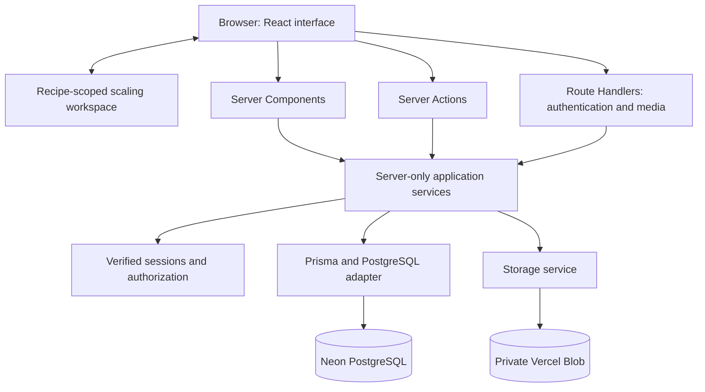

# System Architecture

**Project:** Recipe Sharing and Adaptive Ingredient Scaling

**Revision:** November 8, 2026

**Scope:** Application structure, persistence, access control, media, and scaling

## 1. Purpose and scope

The application enables users to create, publish, discover, and bookmark recipes, then adapt ingredient quantities to a serving count or the available amount of one ingredient. The minimum viable product includes authentication, recipe ownership and visibility, one cover photograph per recipe, public search, bookmarks, and an interactive scaling workspace.

Editable recipe copies, dietary discovery, additional filters, and step photographs follow the minimum viable product. Shopping lists, meal planning, comments, substitutions, and nutrition estimates are outside the initial scope. Detailed acceptance criteria are maintained in [Requirements](requirements.md).

## 2. Architecture overview

The system is a modular monolith built with the Next.js App Router. The interface and server application share one TypeScript repository and one deployment. Feature modules contain validation, queries, and application rules; route files remain thin entry points.



Server Components call services directly for reads. Server Actions validate form submissions and call the same services for changes. Route Handlers provide the HTTP interfaces required for authentication callbacks and image delivery. Client Components receive serializable data and manage interaction; they do not import database or storage code.

## 3. Technology decisions

| Responsibility | Technology | Rationale |
| --- | --- | --- |
| Application runtime | Node.js 24, Next.js 16, React 19, TypeScript | One application for interface rendering and server operations. |
| Interface | Tailwind CSS 4 and HeroUI 3 | Shared styling and accessible component primitives. HeroUI 3 styles load after Tailwind. |
| Relational persistence | Neon PostgreSQL and Prisma 7 | Typed queries, relational constraints, and versioned migrations. |
| Database transport | `@prisma/adapter-pg` and `pg` | PostgreSQL connections with interactive transaction support. Runtime pools have bounded size and connection timeouts. |
| Authentication | Better Auth | Planned email/password and Google sign-in with persistent sessions. |
| Input validation | Zod | Shared input contracts with explicit size and numeric limits. |
| Scaling state | Redux Toolkit | Planned recipe-scoped state for controls, derived quantities, warnings, undo, and reset. |
| Photograph storage | Private Vercel Blob | Store image bytes separately from relational metadata. |
| Image validation | Sharp | Decode actual JPEG, PNG, and WebP content with byte, pixel, and processing limits. |
| Hosting | Vercel | Deploy the Next.js application as one unit. |
| Verification | Vitest, PGlite, ESLint, TypeScript, production builds | Test application boundaries and migration constraints without cloud credentials. |

Prisma CLI, client, and adapter use the same pinned version. The dependency lockfile records installed versions. Database migrations have one owner and one history; no second ORM is introduced.

## 4. Repository structure and boundaries

```text
app/
  api/health/route.ts       Public application liveness
  layout.tsx               Shared document and styles
  page.tsx                 Application entry page
lib/
  config/env.ts            Validated server configuration
  db/client.ts             Lazy, server-only Prisma client
  recipes/
    schemas.ts             Bounded recipe input contracts
    access.ts              Visibility query predicates
    service.ts             Session-aware CRUD and transactional recipe writes
  storage/
    image.ts               Bounded image content inspection
    blob.ts                Private Blob SDK adapter
    service.ts             Owner-scoped upload/read and compensating cleanup
prisma/
  schema.prisma            Persistent model definitions
  migrations/              Baseline and additive SQL migrations
  README.md                Database adoption and migration procedure
tests/                     Input, service-boundary, and migration tests
```

Authentication, media, and scaling modules are added alongside recipes as their workflows are implemented. Browser-safe schemas and pure calculations remain separate from server-only modules. Generated Prisma output is a build artifact, regenerated from the schema.

Services accept a session reader supplied by the server authentication module. Identity must come from a verified session, never from form data or a submitted owner ID. Product mutation endpoints remain closed until authentication is integrated. A separate local tester uses a fixed identity inside a dedicated development schema.

## 5. Data model

| Model | Responsibility and constraints |
| --- | --- |
| `User` | Existing user profile, mapped to `users`; retains UUID identifiers and unique email addresses. Authentication account and session records will be added separately. |
| `StoredFile` | Existing `files` metadata: owner, private pathname, media type, byte size, and creation time. File size remains positive. Image bytes remain in Blob storage. |
| `Recipe` | Author, title, description, original serving count, preparation and cooking times, difficulty, visibility, timestamps, and optional unique cover association. Visibility defaults to private. |
| `RecipeIngredient` | Recipe, position, display name, normalized search name, original decimal quantity, unit, and note. Each position is unique within a recipe. |
| `RecipeStep` | Recipe, position, and instruction. Each position is unique within a recipe. |
| `Bookmark` | User-to-recipe reference with a composite primary key preventing duplicate saves. |

Servings use `Decimal(12,4)` and ingredient quantities use `Decimal(16,6)`. Service responses serialize decimals as strings to preserve stored precision. The future scaling adapter will validate conversion to finite JavaScript numbers at its boundary. Display rounding must not be written back to the recipe.

Input contracts allow 1–100 ingredients and steps, a title of up to 160 characters, positive servings up to 10,000, and nonnegative preparation/cooking times up to 10,080 minutes each. Quantified ingredients require a unit and a positive quantity of at most 1,000,000. Unquantified entries require a descriptive note, such as “to taste.” Database checks reinforce numeric ranges, nonempty content, and valid ingredient measurements.

Recipe deletion cascades to ingredient, step, and bookmark records. It retains the independently owned file metadata so storage cleanup can be coordinated separately. Deleting file metadata clears the cover association. User deletion is restricted while owned recipes or files exist; account removal will require an explicit cleanup workflow.

### Existing database compatibility

The baseline migration represents the existing `users` and `files` tables. Read-only inspection confirmed their column types and constraints. The recipe migration adds new tables without recreating either existing table.

On an existing database, verify and record the baseline before applying later migrations. On an empty development database, apply both migrations normally. Setup, installation, tests, and builds never apply migrations. See the [database workflow](../prisma/README.md) for the procedure.

## 6. Application flows

### Create and read a recipe

1. Resolve the verified server session and reject unauthenticated creation.
2. Parse the recipe input. Generate ownership and ingredient/step positions on the server.
3. If a cover is supplied, require an eligible, unattached image owned by the session user.
4. Create the recipe, ingredients, and steps in one database transaction.
5. Return the recipe identifier; an interface can then navigate to its detail view.

Detail queries include visibility in the database predicate: an anonymous viewer sees public recipes; a signed-in viewer may also see their own private recipes. An inaccessible or nonexistent recipe returns the same absent result. Responses exclude account credentials and private Blob paths.

### Edit, discovery, and bookmarks

Edit and delete services constrain writes by the session user's identifier. Updates replace ordered ingredients and steps in the recipe transaction; owned listing is bounded to 50 records. Public discovery will filter visibility before applying title/ingredient search and bounded pagination. Saved views will reapply access rules when reading bookmark references. Making a recipe private must revoke public detail, discovery, bookmark-display, and image access.

Owned listing, creation, detail reads, editing, and deletion are implemented as internal services. Product interfaces, public discovery, and bookmark workflows remain planned.

### Cover photographs

The internal upload service requires a verified session reader, enforces a 3 MiB limit, and decodes actual JPEG, PNG, or WebP content. It limits decoded images to 16 million pixels, rejects animation, and bounds processing time. Storage paths use server-generated identifiers; MIME type comes from decoded content. Upload success persists owned file metadata. Metadata checks during recipe creation supplement this inspection.

Images will be delivered through a server route that checks the associated recipe's visibility. Public recipe images can be viewed without signing in; private recipe images require the owner. Blob tokens and private paths remain server-only. Authorized responses must avoid shared caching that could retain private content or survive a visibility change.

Blob operations cannot participate in a PostgreSQL transaction. Failed upload/metadata writes trigger compensating deletion of the attempt's unique path. A cleanup failure retains that path in a server-side error for retry. Automated reconciliation and recipe replacement/deletion cleanup remain planned.

The owner-scoped image reader checks file ownership before accessing Blob and keeps private paths out of its response. It supports image management; public/private recipe photo delivery still needs the visibility-aware route described above. Product upload and media HTTP endpoints remain closed before authentication is integrated; the local tester has separate development-only endpoints.

## 7. Scaling and workspace state

The scaling engine will be a pure TypeScript module independent of React, Redux, authentication, and persistence. It will always calculate from original quantities:

- **Serving mode:** factor = target servings / original servings.
- **Ingredient mode:** factor = available quantity / original required quantity after conversion to compatible units.
- **Output:** original quantity × factor, with implied servings derived from the same factor.

Only documented conversions within mass or volume dimensions will be enabled. Count quantities scale numerically and generate warnings for impractical fractions. Unmeasured ingredients remain unchanged and cannot drive scaling. Unknown units, incompatible dimensions, and nonpositive or nonfinite inputs are rejected as constraints. The engine will not infer mass from volume or adjust cooking time and temperature.

A Redux store will be created per recipe workspace. State includes mode, target servings, selected ingredient, available quantity/unit, and bounded undo history. Selectors derive quantities and warnings from the same configuration. Switching modes preserves the active factor; undo restores a coherent prior configuration; reset returns to base quantities. A recipe change creates a new workspace and clears stale history. No server-global Redux store is used.

### Planned extensions

A recipe copy will create independent private recipe, ingredient, and step records in one transaction, with source provenance. Source edits will not alter the copy. Photograph copying requires a separate storage and ownership policy before implementation; bookmarks remain references to the original recipe.

Dietary discovery will use structured ingredient-to-allergen relationships and separate user dietary preferences from declared allergies. Missing mappings remain unknown rather than evidence of suitability. These extensions do not change the core scaling calculation.

## 8. Configuration and operational behavior

`.env.example` documents configuration names without credentials. Runtime database operations validate `DATABASE_URL` only when first used. Prisma CLI uses `DIRECT_URL` when configured and otherwise falls back to `DATABASE_URL`. The homepage, liveness endpoint, tests, and build do not require cloud credentials.

`GET /api/health` returns application liveness with `Cache-Control: no-store`. It does not query the database or storage and is not a readiness check.

Development, preview, and production must use deliberately selected resources before database mutations. Secrets remain outside Git and browser bundles. Production database changes and application deployment are separate operations from local setup.

### Local backend integration page

`/backend-test` is a minimal development interface with multiple ingredient rows, one editable cooking step, CRUD buttons, image controls, and raw API responses. Ingredient names, quantities, units, notes, and order survive loading and editing; additional saved cooking steps are retained. Its routes require development mode, a loopback host, and same-origin writes. They use the normal services against a separate schema prepared with `npm run backend-test:setup`; production requests return 404. Local schema/user configuration is ignored by Git. The test identity does not implement or replace product authentication. The main application page remains available for product frontend development. See the [run instructions](../README.md#simple-local-backend-tester).

## 9. Implementation status and delivery sequence

| Area | Current implementation | Remaining work |
| --- | --- | --- |
| Foundation | Prisma configuration/client, environment template, HeroUI styles, liveness route, setup tooling, automated checks, and verified GitHub Actions | Keep CI passing and configure deployment resources. |
| Persistence | Mapped legacy models; recipe, ingredient, step, and bookmark models; migration SQL and real Prisma CRUD/rollback verified in a disposable cloud schema | Review/baseline the application database and apply migrations. Public-schema migrations remain unapplied. |
| Recipe services | Zod contracts, visibility-filtered reads, owner-scoped listing/creation/update/delete, transactional child writes, cover checks | Connect verified authentication and product interfaces. |
| Authentication | Session-reader integration contract | Better Auth schema, configuration, account views, Google callbacks, and two-account verification. |
| Media | Decoded image validation, private Blob adapter, owner-scoped upload/read services, compensating cleanup, and a verified live sample round trip | Authentication/UI integration, visibility-aware recipe photo delivery, deletion workflow, and automated cleanup reconciliation. |
| Discovery and collections | Normalized ingredient search field, visibility index, and unique bookmark constraint | Browse/search queries, pagination, saved/owned views, and bookmark services. |
| Scaling | Architecture and ingredient input contract | Pure engine, unit catalog, Redux workspace, and interactive interface. |

The first integrated milestone is authentication with recipe create/view. Recipe editing, deletion, cover uploads, discovery, and bookmarks follow. Scaling and coordinated state complete the minimum viable product. Optional copies and dietary discovery begin after core acceptance checks pass.

Local automated checks cover validation, session/visibility boundaries, image inspection, compensating cleanup, decimal serialization, and migration behavior. Unit service tests mock Prisma; PGlite tests apply the migration SQL locally. The local tester was also exercised in the browser for create/read/update/delete and image upload/preview/removal.

The manual `storage:check` command also verifies the real Prisma adapter and migrations on the configured PostgreSQL server within a disposable schema, plus private Blob upload/read/delete and ownership checks. The November 8 CRUD review passed all 17 checks, including real service updates/deletes, two-identity write isolation, and rollback of an update whose replacement child fails. It removed its schema and sample objects. Public application tables and migration history were not changed. Browser authentication, recipe visibility-aware product media routes, product responsive layouts, and deployment checks remain outstanding. See the [recorded results](storage-test-results.json) and [CRUD review](crud-review.md).

## 10. Design references

- [Next.js data access and security](https://nextjs.org/docs/app/guides/data-security)
- [Prisma 7 configuration and adapters](https://docs.prisma.io/docs/guides/upgrade-prisma-orm/v7)
- [Prisma migration baselining](https://www.prisma.io/docs/orm/v7/prisma-migrate/workflows/baselining)
- [HeroUI 3 setup](https://heroui.com/en/docs/react/getting-started/quick-start)
- [Project proposal](proposal.md) and [requirements](requirements.md)
