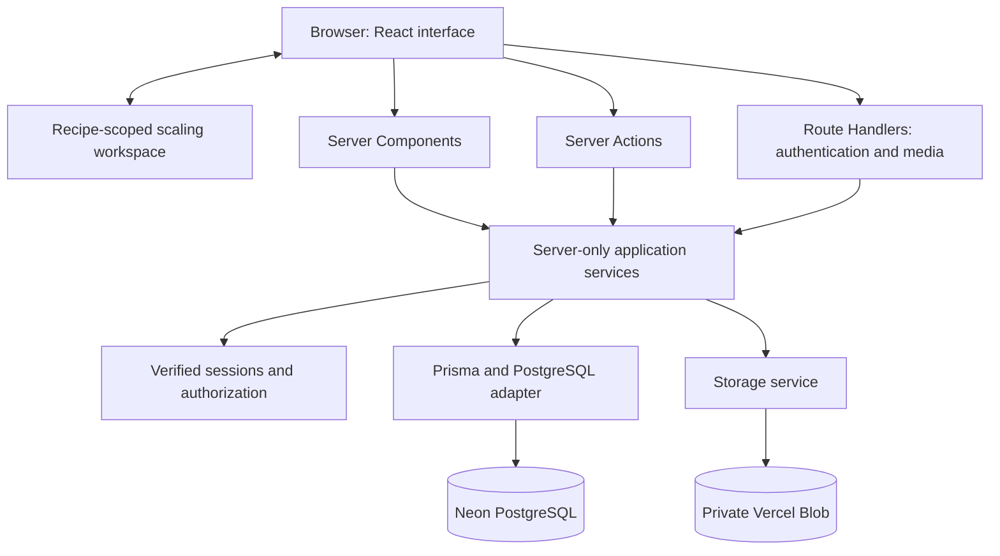

# System Architecture

Recipe Sharing and Adaptive Ingredient Scaling · Design recorded November 8, 2026

The product screens use server-side recipe queries, authenticated Server Actions, and a recipe-scoped Redux store for ingredient scaling.

## 1. Purpose and scope

The recipe backend supports public and private recipes, title and ingredient search, bookmarks, editable private copies, and optional dietary conflict filtering. The scaling controls adjust ingredient quantities for a different serving count or an ingredient the cook has on hand. [Requirements and priorities](requirements.md)

## 2. Architecture overview

Next.js serves the pages, Server Actions, and HTTP routes from one TypeScript project.



Server Components can call recipe queries directly. Server Actions handle edits, bookmarks, and cover uploads. HTTP routes handle authentication requests and image reads. Database access and storage credentials stay on the server.

## 3. Technology decisions

| Responsibility | Technology | Rationale |
| --- | --- | --- |
| Application runtime | Node.js 24, Next.js 16, React 19, TypeScript | One application for interface rendering and server operations. |
| Interface | Tailwind CSS 4 and HeroUI 3 | Shared styling and accessible component primitives. HeroUI 3 styles load after Tailwind. |
| Relational persistence | Neon PostgreSQL and Prisma 7 | Typed queries, relational constraints, and versioned migrations. |
| Database transport | `@prisma/adapter-pg` and `pg` | PostgreSQL connections with interactive transaction support. Runtime pools have bounded size and connection timeouts. |
| Authentication | Better Auth | Email/password accounts and database-backed sessions. Google sign-in requires OAuth credentials and a verified callback. |
| Input validation | Zod | Shared input contracts with explicit size and numeric limits. |
| Scaling state | Redux Toolkit | Recipe-scoped state for controls, derived quantities, warnings, undo, and reset. |
| Photograph storage | Private Vercel Blob | Store image bytes separately from relational metadata. |
| Image validation | Sharp | Decode actual JPEG, PNG, and WebP content with byte, pixel, and processing limits. |
| Hosting | Vercel | Deploy the Next.js application as one unit. |
| Verification | Vitest, PGlite, ESLint, TypeScript, production builds | Test application boundaries and migration constraints without cloud credentials. |

The lockfile pins the Prisma CLI, client, and PostgreSQL adapter together. The schema history lives in the SQL migrations under `prisma/migrations/`.

## 4. Repository structure and boundaries

```text
app/
  actions.ts               Recipe writes, bookmarks, cover uploads, sign-out
  api/auth/[...all]/        Better Auth requests and callbacks
  api/images/[id]/          Access checks and image downloads
  api/health/route.ts       Application health check
  layout.tsx               Shared document and styles
  page.tsx                 Explore, owned recipes, and saved recipes
  account/                 Account forms and sign-in
  recipes/                 Recipe detail, editor, and scaling controls
lib/
  auth/server.ts           Better Auth setup and session lookup
  config/env.ts            Validated server configuration
  db/client.ts             Lazy, server-only Prisma client
  product/queries.ts       Search, collections, and recipe detail
  product/storage.ts       Selects local files or private Blob storage
  recipes/
    scaling.ts             Pure scaling engine and unit conversions
    scaling-workspace.ts   Redux store, undo history, and selectors
    schemas.ts             Bounded recipe input contracts
    access.ts              Visibility query predicates
    service.ts             Session-aware CRUD and transactional recipe writes
  storage/
    image.ts               Bounded image content inspection
    blob.ts                Private Blob SDK adapter
    service.ts             Owner-scoped upload/read and compensating cleanup
prisma/
  schema.prisma            Persistent model definitions
  migrations/              Baseline and additive SQL migrations
  README.md                Database adoption and migration procedure
tests/                     Input, service-boundary, and migration tests
```

Product mutations get the user ID from the Better Auth session. The development tester uses a fixed identity in its own database schema. Prisma generates the TypeScript client from `schema.prisma`.

## 5. Data model

| Model | Responsibility and constraints |
| --- | --- |
| `User` | Stores a stable UUID, unique email, unique editable username, display name, and optional profile photo. Recipes and sessions reference the UUID. |
| `Account`, `Session`, `Verification` | Better Auth stores credentials or provider links, expiring sessions, and verification records in separate tables. |
| `StoredFile` | File owner, private pathname, media type, positive byte count, and creation time. The image bytes live in private Blob storage or the local test directory. |
| `Recipe` | Author, title, description, original serving count, preparation and cooking times, difficulty, visibility, timestamps, and optional unique cover association. Visibility defaults to private. |
| `RecipeIngredient` | Recipe, position, display name, normalized search name, original decimal quantity, unit, and note. Each position is unique within a recipe. |
| `RecipeStep` | Recipe, position, and instruction. Each position is unique within a recipe. |
| `Bookmark` | User-to-recipe reference with a composite primary key preventing duplicate saves. |

PostgreSQL assigns a unique starter username to each profile. A cook can choose a new handle immediately under Account → Profile. Each successful rename starts a one-calendar-month waiting period, measured in UTC. Display names can be shared by multiple cooks and edited at any time. Recipe bylines link the display name and handle to the cook’s recipe page by stable UUID. Email registration takes the display name from the sign-up form. For a new Google registration, Better Auth uses the Google profile name and photo when supplied and links the Google subject ID to the local UUID. Later Google sign-ins preserve local profile edits.

Servings use `Decimal(12,4)` and ingredient quantities use `Decimal(16,6)`. Service responses serialize decimals as strings to preserve stored precision. The scaling engine converts these strings to finite, positive JavaScript numbers for calculation. Display rounding applies only when formatting the preview.

Input contracts allow 1–100 ingredients and steps, a title of up to 160 characters, positive servings up to 10,000, and nonnegative preparation/cooking times up to 10,080 minutes each. Quantified ingredients require a unit and a positive quantity of at most 1,000,000. Unquantified entries require a descriptive note, such as “to taste.” Database checks reinforce numeric ranges, nonempty content, and valid ingredient measurements.

Recipe deletion cascades to ingredient, step, and bookmark records. It retains the independently owned file metadata so storage cleanup can be coordinated separately. Deleting file metadata clears the cover association. User deletion is restricted while owned recipes or files exist; account removal will require an explicit cleanup workflow.

### Existing database compatibility

The baseline describes the original `users` and `files` tables, whose column types and constraints were checked during the initial database review. The recipe migration adds recipes, ingredients, steps, and bookmarks. The authentication migration adds account, session, and verification tables and extends the existing user profile.

The copy migration adds a nullable `source_recipe_id` to recipes. Existing recipes keep a null value. The source UUID records which recipe was copied and remains available after the source is deleted. The public detail response omits this internal field.

For an empty development database, apply the committed migrations. An existing database with matching tables needs its baseline recorded first. The build generates the client. Migration tests run SQL against an in-memory database, and local setup for the integration tests migrates its own PostgreSQL cluster. [Database setup and baselining](../prisma/README.md)

## 6. Application flows

### Create and read a recipe

1. Resolve the verified server session and reject unauthenticated creation.
2. Parse the recipe input. Generate ownership and ingredient/step positions on the server.
3. If a cover is supplied, require an eligible, unattached image owned by the session user.
4. Create the recipe, ingredients, and steps in one database transaction.
5. Return the recipe identifier; an interface can then navigate to its detail view.

Detail queries include visibility in the database predicate: an anonymous viewer sees public recipes; a signed-in viewer may also see their own private recipes. An inaccessible or nonexistent recipe returns the same absent result. Responses exclude account credentials and private Blob paths.

### Edit, discovery, and bookmarks

Only the author can edit or delete a recipe. Edits replace the ingredient and step rows in the same transaction. The tester can list up to 50 owned recipes at a time.

Product queries return six recipes per page. Discovery searches public recipe titles and ingredient names and can filter by difficulty. The owned collection filters by author. The saved collection checks both the viewer’s bookmark and their current access to the recipe. A bookmarked recipe disappears from another cook’s results as soon as its author makes it private.

### Cover photographs

A signed-in cook can upload a still JPEG, PNG, or WebP up to 3 MiB and 16 megapixels. Sharp decodes the bytes under a time limit. The server determines the media type and storage path, then saves the file metadata under the cook’s user ID. Attaching the cover to a recipe also checks ownership.

`GET /api/images/[id]` looks up the file before reading it from storage. Anyone can read a public recipe’s cover. Only the owner can read a private or unattached image. Responses use `Cache-Control: private, no-store` so a cached public copy cannot bypass a later visibility change.

Blob writes happen outside the SQL transaction. If saving metadata fails after an upload, the service deletes the new object. If deletion also fails, the product action logs the generated storage path to the private server log. Manual cleanup covers unattached files older than 24 hours and unrecorded uploads in a verified product user’s Blob prefix. [Cloud cleanup procedure](../prisma/README.md#reclaim-unused-cloud-covers)

## 7. Scaling and workspace state

The shared TypeScript engine accepts the original recipe detail and a scaling request. The serving control divides the target servings by the original servings. The available-ingredient control expresses the available and required quantities in compatible units, then divides the available quantity by the requirement. Both modes multiply every measured row by that factor and return the resulting servings, adjusted quantities, and warnings. [Frontend integration guide](recipe-scaling.md)

The engine supports mass, volume, and count units. It reports incompatible units and invalid inputs, preserves unmeasured ingredients, and warns about fractional counts. Cooking steps, times, and temperatures retain their original values.

Each recipe workspace creates its own Redux store. State includes mode, target servings, selected ingredient, available quantity/unit, and bounded undo history. Selectors derive quantities and warnings from the same configuration. Switching modes preserves the active factor. Undo restores the previous settings, and reset returns to base quantities. A recipe change creates a new workspace and clears stale history. No server-global Redux store is used.

### Editable copies

A signed-in cook can copy a public recipe into their own collection. One transaction reads the source and creates a private recipe with new ingredient and step rows. Later edits and deletion of either recipe leave the other intact. The copy starts without a cover, and its owner can upload their own photo in the editor.

### Dietary preferences and ingredient matches

Each signed-in cook can save a vegetarian or vegan preference and a separate list of allergens. Settings belong to the session user. Recipe cards and details compare the cook’s settings with a shared catalogue using each ingredient’s stored canonical name. The catalogue records dietary classifications and positive ingredient-to-allergen links. Exact-name matching also works for existing recipes and editable copies. Contributors can extend the catalogue through a reviewed data migration.

Choosing to hide recorded conflicts applies the filter to the database query before counting and paginating. Ingredients without a matching profile remain visible with an incomplete-information notice. A product’s ingredients, preparation, and cross-contact can vary. The supported allergen and sulphite categories follow Canadian labelling terminology. [Canadian Food Inspection Agency consumer guide](https://inspection.canada.ca/en/food-labels/labelling/consumers/food-allergies)

## 8. Configuration and operational behavior

`.env.example` documents configuration names without credentials. Runtime database operations validate `DATABASE_URL` only when first used. Prisma CLI uses `DIRECT_URL` when configured and otherwise falls back to `DATABASE_URL`. The homepage, liveness endpoint, tests, and build do not require cloud credentials.

`GET /api/health` returns application liveness with `Cache-Control: no-store`. It does not query the database or storage and is not a readiness check.

Development, preview, and production must use deliberately selected resources before database mutations. Secrets remain outside Git and browser bundles. Production database changes and application deployment are separate operations from local setup.

### Local backend integration page

`/backend-test` lets a developer edit ingredient rows and one cooking step, upload a cover, and inspect the API response. Loading and saving preserves the ingredient order and any additional stored steps. Its routes accept loopback requests in development and require a matching origin for writes. `npm run backend-test:setup` creates the tester’s schema. Production requests return 404. [Run the tester](../README.md#simple-local-backend-tester)

## 9. Integration and test coverage

On November 8, the team tested recipe edits and image upload, preview, and removal in the browser. All 17 live storage checks passed. The checks used a disposable PostgreSQL schema and private Blob objects, verified rollback and two-user access, and removed the test data afterward. [CRUD review](crud-review.md) · [Storage test results](storage-test-results.json)

The combined backend has a separate local check for email/password sessions, private and public recipe access, cover images, and bookmarks. It uses a local PostgreSQL cluster and local media files. Unit tests cover validation and service behavior, and PGlite tests apply the migration SQL.

Local UI checks covered recipe editing, scaling controls, warnings, undo and reset, and responsive layouts down to 350 px. Unit tests exercise the scaling engine and Redux transitions. The Playwright check signs in two users and follows a cover and recipe through creation, publication, bookmarking, and revocation. It checks the same detail and media URLs before and after a visibility change. The remaining preprod checks cover Google consent and session restoration on the registered origin, and the integrated private Blob upload and visibility flow. [Run the browser check](../README.md#everyday-use)

## 10. Design references

- [Next.js data access and security](https://nextjs.org/docs/app/guides/data-security)
- [Prisma 7 configuration and adapters](https://docs.prisma.io/docs/guides/upgrade-prisma-orm/v7)
- [Prisma migration baselining](https://www.prisma.io/docs/orm/v7/prisma-migrate/workflows/baselining)
- [HeroUI 3 setup](https://heroui.com/en/docs/react/getting-started/quick-start)
- [Project proposal](proposal.md) and [requirements](requirements.md)
